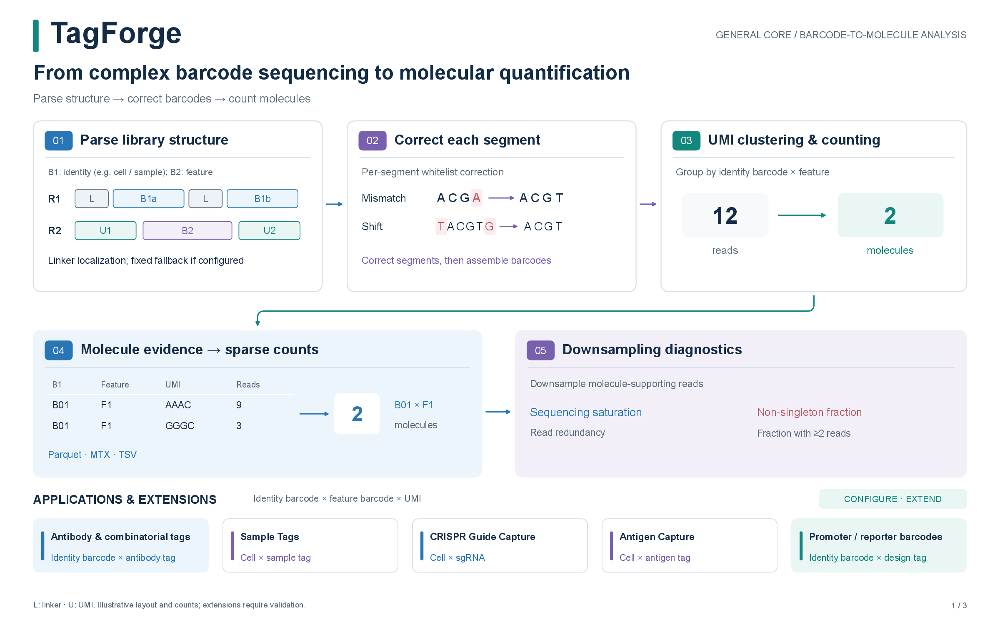
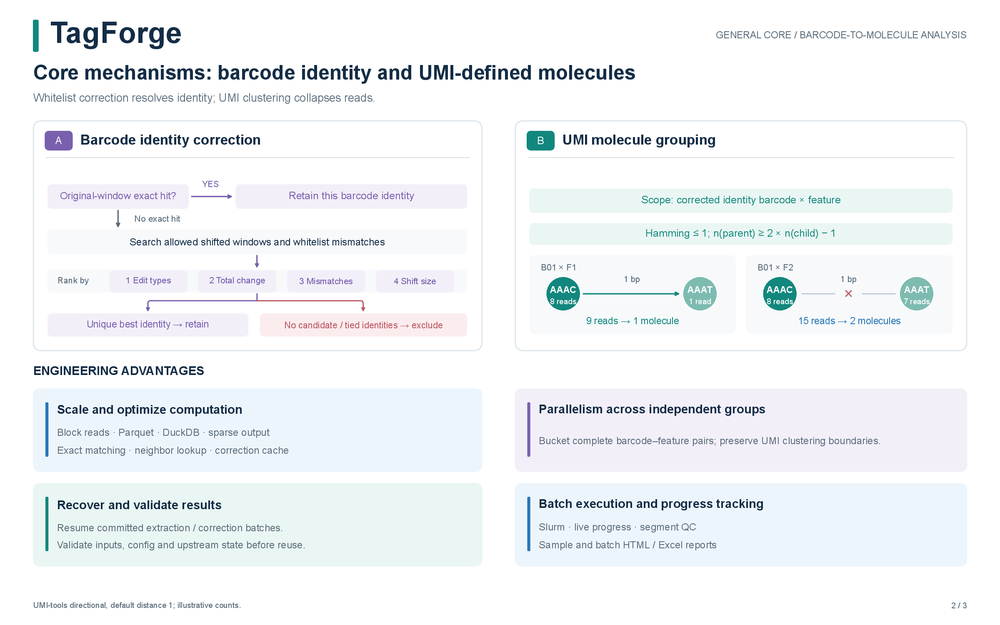
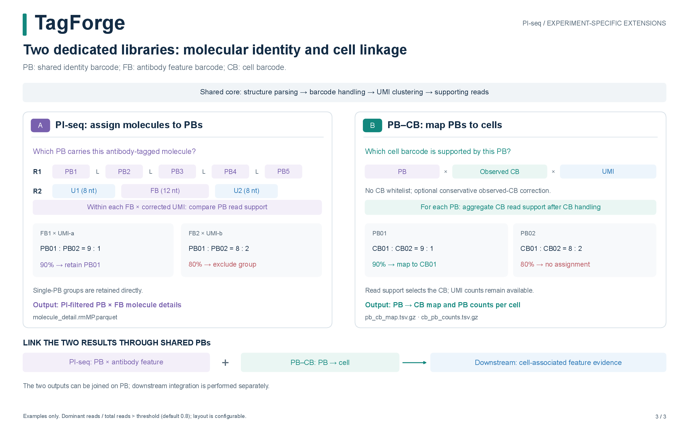

# TagForge 2.0.0

English | [简体中文](README.zh-CN.md)

**From complex barcode sequencing data to traceable molecular evidence and quantitative results.**

TagForge is a command-line framework for libraries with an **identity barcode,
a feature barcode, and a UMI**. It parses segments across paired-end reads,
corrects barcode identity against whitelists, and clusters UMIs into molecule
counts. Identity barcodes distinguish cells, samples, or other experimental
units; feature barcodes identify the measured labels.

Antibody-tag and combinatorial-barcode libraries are primary applications.
PI-seq multi-PB filtering and PB–CB mapping are experiment-specific extensions
built on the same core.

## How it works

**Parse library structure → correct barcode segments → cluster UMIs → produce molecule evidence, sparse counts, and diagnostics.**



<details>
<summary>Core decisions and engineering advantages — second page</summary>



</details>

<details>
<summary>Dedicated PI-seq and PB–CB libraries — third page</summary>



</details>

[Method details](docs/method-overview.md) ·
[Three-page PDF](figures/TagForge_core_principle.en.pdf) ·
[HTML — download and open locally](figures/TagForge_core_principle.en.html)

**Potential extensions:** Sample Tags, CRISPR Guide Capture, Antigen Capture,
and promoter/reporter barcode libraries can use the same barcode–feature–UMI
model when their segments and identities are directly extractable. Each library
requires configuration and data validation; see the method guide for input
requirements and downstream analysis scope.

## Why TagForge?

- **Adapt to your library.** Define barcode and UMI segments across R1 and R2,
  using fixed positions, linker matching, or linker matching with fixed fallback.
- **Count corrected molecules.** Combine whitelist-based barcode correction
  with UMI-tools clustering and library-specific filtering or mapping.
- **Process large datasets.** Stream FASTQ reads into compressed Parquet tables,
  use disk-backed aggregation, and export sparse matrices on demand.
- **Resume with confidence.** Reuse validated completed stages and recover
  committed extraction and correction batches after an interruption.
- **Explore results in one place.** Review sample and batch QC, molecule counts,
  and saturation curves in interactive HTML reports and Excel workbooks.
- **Scale across samples.** Discover samples automatically and generate Slurm
  array jobs for cluster execution.

## Install

The recommended environment is **Linux with Python 3.11**. The included Conda
specification installs Cutadapt, UMI-tools, DuckDB, PyArrow, and GNU coreutils.

```bash
git clone https://github.com/yuanfu-bio/TagForge.git
cd TagForge
conda env create -f environment.yml
conda activate tagforge
python -m pip install . --no-deps --no-build-isolation
tagforge --version
```

## Run your first example

Create a self-contained synthetic project and run the complete workflow:

```bash
tagforge init-example --out tagforge-demo
tagforge validate-config --config tagforge-demo/00_config/config.yaml
tagforge run --config tagforge-demo/00_config/config.yaml
```

The example includes barcode mismatches, a positional shift, linker fallback,
and duplicate reads. It produces **9 valid reads and 6 corrected molecules**.

Open these files to explore the results:

- `tagforge-demo/02_output/example/06_report/example.report.html`
- `tagforge-demo/02_output/00_report/TagForge_batch_report.html`
- `tagforge-demo/02_output/00_report/TagForge_batch_report.xlsx`

HTML reports use Plotly from a CDN for interactive charts; Excel workbooks are
available for offline review.

## Analyze your data

Use the generated example as a starting project. Update
`00_config/config.yaml`, the barcode whitelists, and the feature annotation to
match your library. A typical project looks like this:

```text
my-project/
├── 00_config/
│   ├── config.yaml
│   ├── CELL_WL.txt
│   ├── FB_WL.txt
│   └── FB_info.tsv
├── 01_raw/
│   └── sample-A/
│       ├── sample-A_raw_1.fq.gz
│       └── sample-A_raw_2.fq.gz
└── 02_output/                 # created by TagForge
```

The main configuration choices are:

| Setting | What to configure |
| --- | --- |
| `project` | Project name, working directory, and output directory. |
| `samples` | Automatic discovery from a shared FASTQ layout, or explicit sample paths. |
| `barcode1` | Identity barcode segments and their whitelists, such as CELL or PB. |
| `barcode2` | Feature barcode segments, or observed CB sequences for PB–CB libraries. |
| `umi` | UMI segments in the order they should be concatenated. |
| `barcode2_annotation` | Feature barcode IDs, sequences, and antibody names. |
| `correction_barcode` / `correction_umi` | Barcode correction and UMI clustering settings. |
| `library.type` | `standard` (default), `pi-seq`, or `pb-cb`. |
| `performance` | Worker count, batch size, and resource settings. |

With `project.workdir: ..` in `00_config/config.yaml`, input and output paths
are relative to the project root. Fixed segment positions are **0-based**:
`start: 6, length: 8` extracts bases `[6, 14)`. Multiple segments are
concatenated in configuration order. `methods: [linker, fixed]` tries linker
extraction first, then fixed coordinates on the original read when needed.

See the [configuration template](configs/config.example.yaml) for a complete
working example. Validate your configuration, then run all discovered samples:

```bash
tagforge validate-config --config my-project/00_config/config.yaml
tagforge run --config my-project/00_config/config.yaml --threads 8
```

By default, `run` first checks the leading 10,000 read pairs from each sample.
You can inspect this subset separately or choose one sample:

```bash
tagforge quick-test --config my-project/00_config/config.yaml --reads 10000
tagforge run --config my-project/00_config/config.yaml --sample sample-A
```

To continue an interrupted run, repeat the same `run` command. TagForge checks
inputs, settings, and upstream results before reusing completed stages. Use
`--overwrite` when you want to recompute results.

## Find your results

Each sample has an output directory organized by processing stage:

```text
02_output/
├── 00_report/                # batch HTML and Excel reports
└── sample-A/
    ├── 00_logs/              # logs, live progress, and checkpoints
    ├── 01_extracted/         # extracted segments and extraction QC
    ├── 02_corrected/         # valid reads and barcode correction QC
    ├── 03_molecules/         # deduplicated and PI-filtered molecules
    ├── 04_matrix/            # sparse counts or PB–CB mappings
    ├── 05_downsample/        # saturation curves and sampling metrics
    └── 06_report/            # sample HTML and Excel reports
```

Start with **Main results** in a sample HTML report or **Results** in an Excel
workbook. Batch HTML reports omit the main-result block and downsample note.
Standard and PI-seq workbooks always include `Counts_raw` and `Counts_final`; their counts match when the selected ratio is 1 or downsampling
is disabled. Sample HTML reports and Excel workbooks identify the primary
full-depth output for your library:

| Library | Primary result, relative to the sample directory |
| --- | --- |
| Standard barcode–feature | `04_matrix/{sample}.raw_molecule_pairs.parquet` — sparse barcode-by-feature molecule counts. |
| PI-seq | `03_molecules/{sample}.molecule_detail.rmMP.parquet` — PI-filtered molecules for per-PB analysis. |
| PB–CB | `04_matrix/{sample}.pb_cb_map.tsv.gz` — dominant PB-to-CB assignments. |

Parquet outputs may be a single file or a directory of fragments; read all
fragments as one table. Standard and PI-seq matrix counts represent corrected,
deduplicated UMIs, with PI filtering applied for PI-seq.

Downsampling provides reproducible diagnostic curves by sampling read support
once per ratio within full-depth corrected molecule groups. Reports
separate read-level sequencing saturation from the non-singleton molecule
fraction. The selected ratio maximizes the observed non-singleton fraction; use
full-depth results for primary analysis and interpret the selection as a
diagnostic rather than a sequencing-depth recommendation.

## Common commands

Export a completed standard or PI-seq matrix as TSV, MTX, or Parquet:

```bash
tagforge export-matrix --config my-project/00_config/config.yaml \
  --sample sample-A --format mtx --out sample-A.mtx
```

Run individual stages with `extract`, `correct`, `dedup`, `matrix`,
`downsample`, and `report`; PB–CB libraries use `pair-map` for mapping.
Each stage checks that its upstream results are current. For example:

```bash
tagforge report --config my-project/00_config/config.yaml
tagforge summary --config my-project/00_config/config.yaml
```

`report` refreshes HTML and Excel reports. `summary` rebuilds the batch workbook
from completed samples.

Generate and submit a Slurm array:

```bash
tagforge make-slurm --config my-project/00_config/config.yaml \
  --out slurm_jobs --partition compute --threads 8 --mem 16G \
  --time 24:00:00 --conda-env tagforge
sbatch slurm_jobs/tagforge_array.slurm
```

Use `tagforge --help` or `tagforge <command> --help` for command options.

## Documentation

- [Method overview and application scope](docs/method-overview.md)
- [Example tutorial](docs/tutorial.md)
- [2.0.0 release notes](docs/RELEASE_NOTES.md)
- [Upgrade to 2.0](docs/MIGRATION.md) — archive old-layout sample outputs and rerun to adopt the new workflow.
- [Changelog](docs/CHANGELOG.md)
- [Documentation index](docs/README.md)

## License

TagForge is released under the [MIT License](LICENSE).
