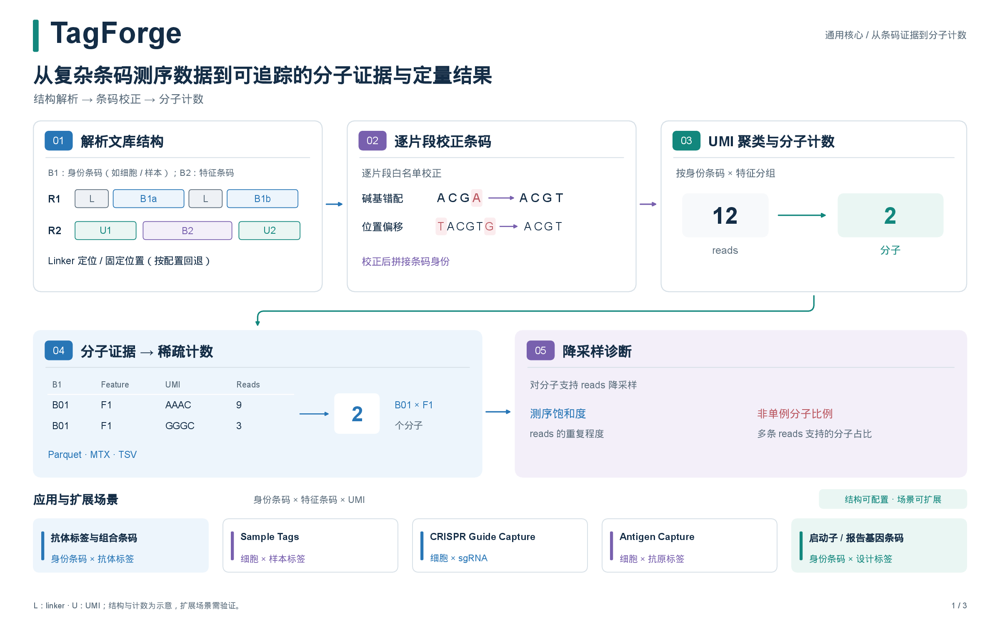
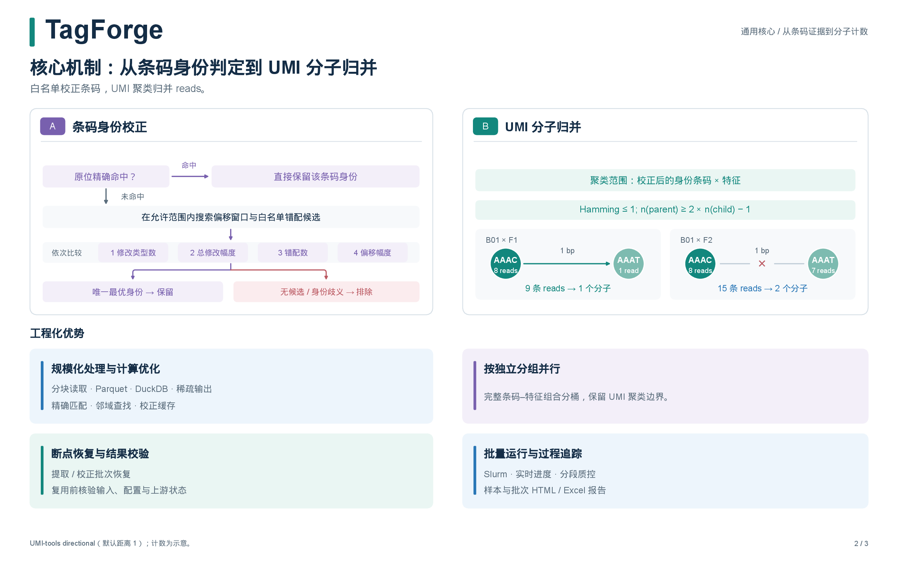
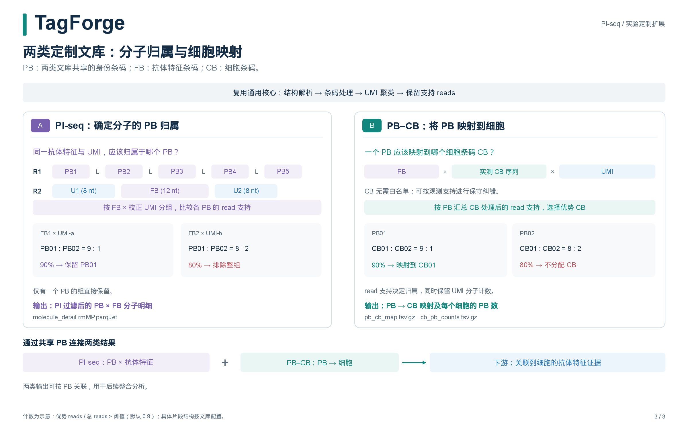

# TagForge 2.0.0

[English](README.md) | 简体中文

**从复杂条码测序数据到可追踪的分子证据与定量结果。**

TagForge 是面向条码编码实验的命令行分析框架，以 **身份条码 × 特征条码 × UMI** 为通用模型，完成双端 reads 的片段解析、逐片段白名单校正、UMI 聚类和分子计数。身份条码用于区分细胞、样本或其他实验单元，特征条码用于识别检测标签。

抗体标签与组合条码文库是主要应用。PI-seq 多 PB 过滤和 PB–CB 映射是建立在通用核心之上的实验定制扩展。

## 工作原理

**结构解析 → 逐片段条码校正 → UMI 聚类 → 分子明细、稀疏计数与诊断。**



<details>
<summary>展开第二页：关键判定与工程化优势</summary>



</details>

<details>
<summary>展开第三页：PI-seq 与 PB–CB 定制文库</summary>



</details>

[原理与适用范围](docs/method-overview.zh-CN.md) ·
[三页 PDF](figures/TagForge_core_principle.zh-CN.pdf) ·
[HTML（下载后在浏览器中打开）](figures/TagForge_core_principle.zh-CN.html)

**可扩展方向：** Sample Tags、CRISPR Guide Capture、Antigen Capture，以及启动子／报告基因条码文库，在片段结构和特征身份可直接解析的前提下，具备使用同一模型的适配基础。各类文库均需配置与数据验证，具体适配条件和下游分析范围见原理说明。

## 为什么选择 TagForge？

- **灵活适配文库结构。** 在 R1 和 R2 中定义条码与 UMI 片段，支持固定位置提取、linker 匹配，以及 linker 匹配失败后的固定位置回退。
- **以校正后的分子计数。** 将条码白名单校正与 UMI-tools 聚类结合，并按文库类型执行过滤或映射。
- **处理大规模数据。** 流式读取 FASTQ，将结果写入压缩 Parquet 表，利用磁盘进行聚合，按需导出稀疏矩阵。
- **支持断点续跑。** 复用经验证的已完成步骤，在任务中断后恢复条码提取与校正阶段已提交的批次。
- **集中查看分析结果。** 通过交互式 HTML 报告和 Excel 工作簿查看样本与批次质控、分子计数及饱和度曲线。
- **扩展到多样本分析。** 自动发现样本，生成 Slurm 数组任务脚本，在集群上批量运行。

## 安装

推荐使用 **Linux 和 Python 3.11**。项目提供的 Conda 环境文件包含 Cutadapt、UMI-tools、DuckDB、PyArrow 和 GNU coreutils。

```bash
git clone https://github.com/yuanfu-bio/TagForge.git
cd TagForge
conda env create -f environment.yml
conda activate tagforge
python -m pip install . --no-deps --no-build-isolation
tagforge --version
```

## 运行第一个示例

创建一个包含配置与模拟数据的独立示例项目，运行完整流程：

```bash
tagforge init-example --out tagforge-demo
tagforge validate-config --config tagforge-demo/00_config/config.yaml
tagforge run --config tagforge-demo/00_config/config.yaml
```

示例涵盖条码错配、位置偏移、linker 提取回退和重复 reads，最终得到 **9 条有效 reads 和 6 个校正后的分子**。

打开以下文件查看结果：

- `tagforge-demo/02_output/example/06_report/example.report.html`
- `tagforge-demo/02_output/00_report/TagForge_batch_report.html`
- `tagforge-demo/02_output/00_report/TagForge_batch_report.xlsx`

HTML 报告通过 CDN 加载 Plotly 以显示交互图表；Excel 工作簿可用于离线查看。

## 分析自己的数据

可以从生成的示例项目开始，根据文库结构修改 `00_config/config.yaml`、条码白名单和特征注释。典型项目结构如下：

```text
my-project/
├── 00_config/
│   ├── config.yaml
│   ├── CELL_WL.txt
│   ├── FB_WL.txt
│   └── FB_info.tsv
├── 01_raw/
│   └── sample-A/
│       ├── sample-A_raw_1.fq.gz
│       └── sample-A_raw_2.fq.gz
└── 02_output/                 # 由 TagForge 创建
```

主要配置项：

| 配置项                                      | 配置内容                                                |
| ------------------------------------------- | ------------------------------------------------------- |
| `project`                                 | 项目名称、工作目录和输出目录。                          |
| `samples`                                 | 按统一 FASTQ 目录结构自动发现样本，或显式指定样本路径。 |
| `barcode1`                                | 身份条码片段及其白名单，如 CELL 或 PB。                   |
| `barcode2`                                | 特征条码片段，或 PB–CB 文库中直接观测到的 CB 序列。    |
| `umi`                                     | UMI 片段，按需要拼接的顺序定义。                        |
| `barcode2_annotation`                     | 特征条码的 ID、序列和抗体名称。                         |
| `correction_barcode` / `correction_umi` | 条码校正与 UMI 聚类参数。                               |
| `library.type`                            | `standard`（默认）、`pi-seq` 或 `pb-cb`。         |
| `performance`                             | 并行进程数、批次大小和资源参数。                        |

在 `00_config/config.yaml` 中设置 `project.workdir: ..` 后，输入与输出路径均相对于项目根目录解析。固定位置提取采用 **从 0 开始的坐标**：`start: 6, length: 8` 提取区间 `[6, 14)`。多个片段按配置顺序拼接；`methods: [linker, fixed]` 优先尝试 linker 提取，失败后按原始 read 的固定坐标提取。

完整配置可参考[配置模板](configs/config.example.yaml)。验证配置后，运行所有已发现的样本：

```bash
tagforge validate-config --config my-project/00_config/config.yaml
tagforge run --config my-project/00_config/config.yaml --threads 8
```

默认情况下，`run` 会先检查每个样本开头的 10,000 对 reads。也可以单独运行快速检查，或仅分析指定样本：

```bash
tagforge quick-test --config my-project/00_config/config.yaml --reads 10000
tagforge run --config my-project/00_config/config.yaml --sample sample-A
```

任务中断后，重新执行相同的 `run` 命令即可继续。TagForge 会检查输入、配置和上游结果，再复用已完成的步骤。如需重新计算，可添加 `--overwrite`。

## 查看分析结果

每个样本的输出按处理步骤组织：

```text
02_output/
├── 00_report/                # 批次 HTML 与 Excel 报告
└── sample-A/
    ├── 00_logs/              # 日志、实时进度与检查点
    ├── 01_extracted/         # 提取的片段与提取质控
    ├── 02_corrected/         # 有效 reads 与条码校正质控
    ├── 03_molecules/         # 去重后的分子与 PI 过滤结果
    ├── 04_matrix/            # 稀疏计数或 PB–CB 映射
    ├── 05_downsample/        # 饱和度曲线与抽样诊断
    └── 06_report/            # 样本 HTML 与 Excel 报告
```

从 HTML 报告的 **Main results** 或 Excel 工作簿的 **Results** 页开始，即可找到对应文库的主要全深度结果：

| 文库类型           | 主要结果，路径相对于样本输出目录                                                               |
| ------------------ | ---------------------------------------------------------------------------------------------- |
| 标准条码–特征文库 | `04_matrix/{sample}.raw_molecule_pairs.parquet` — 条码 × 特征的稀疏分子计数。              |
| PI-seq             | `03_molecules/{sample}.molecule_detail.rmMP.parquet` — 用于逐 PB 分析的 PI 过滤后分子明细。 |
| PB–CB             | `04_matrix/{sample}.pb_cb_map.tsv.gz` — 按优势支持比例确定的 PB 到 CB 映射。                |

Parquet 输出可能是单个文件，也可能是包含多个分片的目录；读取时应将所有分片视为同一张表。标准文库与 PI-seq 的矩阵计数均来自校正、去重后的 UMI，PI-seq 还会执行 PI 过滤。

降采样在全深度校正分子组内对支持 reads 按比例各抽样一次，生成可复现的诊断曲线。报告分别展示 read 层面的测序饱和度与非单例分子比例（由多条 reads 支持的分子占比）。所选抽样比例使观测到的非单例分子比例最大，用于辅助评估文库；主要分析使用全深度结果，抽样比例选择本身不构成测序深度建议。

## 常用命令

将已完成的标准文库或 PI-seq 计数矩阵导出为 TSV、MTX 或 Parquet：

```bash
tagforge export-matrix --config my-project/00_config/config.yaml \
  --sample sample-A --format mtx --out sample-A.mtx
```

可使用 `extract`、`correct`、`dedup`、`matrix`、`downsample` 和 `report` 单独运行各步骤；PB–CB 文库使用 `pair-map` 生成映射。各步骤会检查上游结果是否有效。例如：

```bash
tagforge report --config my-project/00_config/config.yaml
tagforge summary --config my-project/00_config/config.yaml
```

`report` 更新 HTML 与 Excel 报告；`summary` 根据已完成的样本重新生成批次 Excel 工作簿。

生成并提交 Slurm 数组任务：

```bash
tagforge make-slurm --config my-project/00_config/config.yaml \
  --out slurm_jobs --partition compute --threads 8 --mem 16G \
  --time 24:00:00 --conda-env tagforge
sbatch slurm_jobs/tagforge_array.slurm
```

使用 `tagforge --help` 或 `tagforge <command> --help` 查看命令参数。

## 文档

- [核心原理与适用范围](docs/method-overview.zh-CN.md)
- [示例教程](docs/tutorial.md)
- [2.0.0 发布说明](docs/RELEASE_NOTES.md)
- [升级到 2.0](docs/MIGRATION.md) — 归档旧目录结构的样本输出后，重新运行以采用新版流程。
- [更新日志](docs/CHANGELOG.md)
- [文档索引](docs/README.md)

## 许可证

TagForge 采用 [MIT 许可证](LICENSE)。
